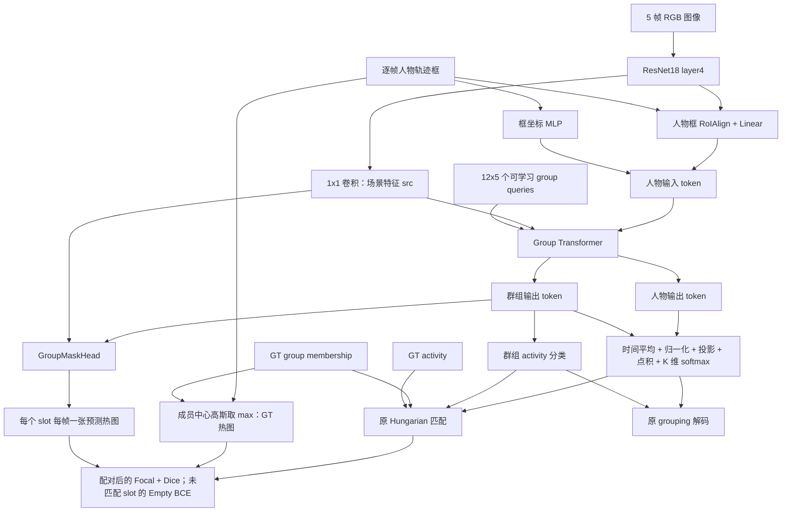
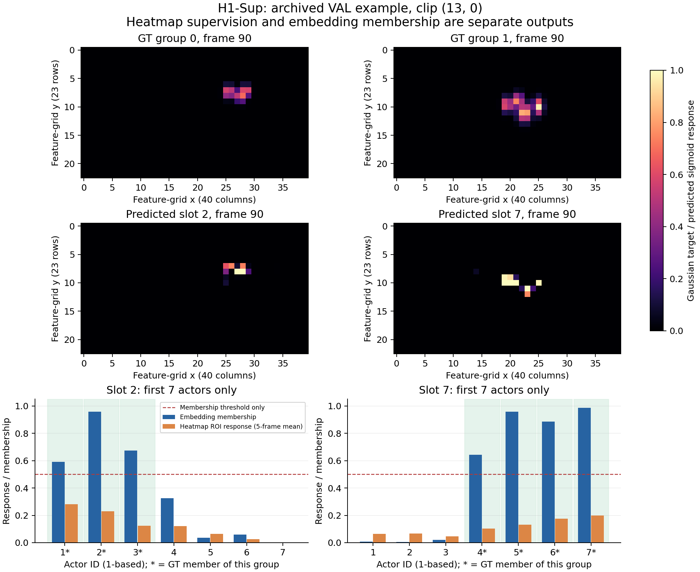

本文对应已经完成的 **H1-Sup seed1**，核对日期为 2026-10-15。核心机制是：**保留 B0 的人物—群组 embedding 分组，让同一个 group token 额外预测本组成员在图像中的空间分布，通过这项辅助任务训练共享表示。**

代码根目录为 `/data2/mzy/GAD/CAFE_heatmap_research_20261012`，运行目录为其下的 `outputs/heatmap/place/remote_h1_sup_seed1_full_run1`。本次逐一比较了运行中保存的 `source_manifest.json`、`source_snapshot` 和当前研究源码，37 个文件的 SHA256 全部一致。下文链接指向这份研究代码。

当前 `CAFE_codebase/models/models.py` 和研究目录的 `models/models.py` 都不是这次实验实际构造的模型。入口由 [models/__init__.py](/data2/mzy/GAD/CAFE_heatmap_research_20261012/models/__init__.py:6) 的 `research_b0_repro=True` 选择 `GADTRB0Repro`。该路线使用 ResNet18；没有调用 HOI graph、TemporalEncoder 或 VideoMAEAdapter。

**先沿下面的数据流理解各模块的关系。** 实线表示前向依赖；heatmap loss 反向更新它上游的共享模块。



这里有两个不同的“匹配”：Hungarian matching 解决预测 slot 与 GT group 的对应；membership prediction 解决某个人属于哪个预测 slot。H1-Sup 新增的热图监督沿用前者，并通过共享特征帮助后者。

**1. 实际配置与张量约定。** 以 [resolved_config.json](/data2/mzy/GAD/CAFE_heatmap_research_20261012/outputs/heatmap/place/remote_h1_sup_seed1_full_run1/resolved_config.json) 为准。

| 符号/配置 | 实际值 | 含义 |
|---|---:|---|
| B | 训练全局 16 | 2 卡各 8；下文 B 泛指当前模型处理的 batch |
| T | 5 | 每个 clip 采样 5 帧 |
| N | 14 | 人物槽位数，真实人数不足时 padding |
| K | 12 | 候选 group 槽位数，不代表每段视频有 12 个真实群组 |
| D | 256 | 场景、人物、群组 token 的隐藏维度 |
| d | 64 | heatmap 点积空间的通道数 |
| 输入 H×W | 720×1280 | RGB 图像大小 |
| 特征 h×w | 23×40 | ResNet18 layer4 网格，步幅约 32 |
| Transformer | 6 层、4 heads、FFN 512 | 帧内交互 |
| crop_size | 5 | 人物特征 RoIAlign 输出 5×5 |
| 类别数 | 6+1 | 6 种 activity/action 加 no-group/no-action |

保存的 `heatmaps_val_0.npz` 实际包含 `masks=[1,12,5,23,40]`、`membership=[1,12,14]`、`activities=[1,12,7]`，与以上推导一致。

**2. 输入来自视频帧和已有的人物轨迹框。** 参见 [dataloader/cafe.py](/data2/mzy/GAD/CAFE_heatmap_research_20261012/dataloader/cafe.py:145)。

训练时将 clip 分成 5 段，每段随机采一帧；验证时取每段中心帧。因此 `random_sampling=false` 不等于训练时固定取帧。图像 resize 至 720×1280，并使用 ImageNet mean/std 归一化。

模型输入为 `x=[B,T,3,H,W]`、`boxes=[B,T,N,4]` 和 `dummy_mask=[B,N]`。框采用归一化的 `(cx,cy,w,h)`。逐帧框取自已有 tracks，并按 actor ID 写入对应人物行；人物行在 clip 内保持一致。GT `members=[1,G,N]` 表示真实群组的成员集合，`activities=[1,G]` 是群组类别。

`targets['boxes']` 是逐帧 track boxes，`targets['gt_boxes']` 是另一份框字段。热图标签实际使用前者。`dummy_mask=True` 表示 padding；criterion 内的 `dummy_idx=1` 则表示真实人物，两者方向相反。

`actor_frame_valid=[B,T,N]` 用于排除缺失轨迹、非有限框、无面积/完全在图像外的框及 padding。不要把数据加载器为缺失轨迹留下的占位框误当真实人物。H1-Sup 的热图分支使用这份逐帧有效性；原 B0 人物分支仍沿用其既有处理。

**3. 特征提取分成场景分支和人物分支。** 参见 [backbone.py](/data2/mzy/GAD/CAFE_heatmap_research_20261012/models/backbone.py:87) 与 [b0_repro.py](/data2/mzy/GAD/CAFE_heatmap_research_20261012/models/b0_repro.py:114)。

ResNet18 将 B、T 合并处理：

```text
[B,5,3,720,1280]
  -> [B*5,3,720,1280]
  -> ResNet18 layer4
  -> F: [B*5,512,23,40]
```

这份 ImageNet 初始化的 backbone 参与训练。这里的“冻结 B0 协议”指控制实验配置；参数没有被冻结，当前配置也没有启用 FrozenBatchNorm。

场景分支对 F 做 `input_proj=Conv2d(512,256,1)`，得到 `src=[B,5,256,23,40]`，供 Transformer 的 scene cross-attention 和热图分支共同使用。空间 sine position encoding 在 Transformer 的 attention 中另外加入；热图 pixel 分支直接取 `src`。

人物分支在原始 512 通道 F 上做 RoIAlign。先把归一化框转换为特征网格上的 xyxy 坐标，得到 `[B*T*N,512,5,5]`；再 flatten 为 12,800 维，经 `Linear(12800,256) → ReLU → Dropout`，加上 `MLP(cx,cy,w,h)` 的位置编码，得到 `actor_features=[B,5,14,256]`。

人物 RoIAlign 使用 `sampling_ratio=1, aligned=True`，并保留边界采样修正。稍后热图读取所用的 `3×3, sampling_ratio=2` 是另一个操作，作用和尺寸不要混淆。

**4. Group Transformer 将人物、群组和场景特征关联起来。** 参见 [b0_transformer.py](/data2/mzy/GAD/CAFE_heatmap_research_20261012/models/b0_transformer.py:36) 及 [逐层 attention](/data2/mzy/GAD/CAFE_heatmap_research_20261012/models/b0_transformer.py:149)。

`group_query_emb` 有 `K*T=60` 个 256 维可学习向量，reshape 为每个 slot、每一帧各自的 query。每帧有 N+K=26 个 query token：14 个来自人物特征，12 个来自 group queries。Transformer 的初始 `tgt` 为零，人物/group 的输入向量通过 `query_pos` 加入 attention 的 Q/K。

每层依次执行：人物间 self-attention 和群组间 self-attention；群组以人物为 K/V 的 cross-attention；人物和群组分别以全图 920 个空间 token 为 K/V 的 cross-attention；FFN、残差与 LayerNorm。人物 self-attention 使用距离阈值 0.2 和 dummy mask；距离按归一化框中心计算，不是 0.2 个像素。

输出 `hs=[1,B*T,N+K,256]`。取前 N 个为人物输出，后 K 个为群组输出。人物输出再加回 `actor_features`，得到 `actor_hs=[B,T,N,256]`；群组得到 `group_hs=[B,T,K,256]`。

这里 T 被并入 attention 的 batch 维，因此没有跨帧 temporal attention。后续按人物 ID / group slot 在时间上求平均，实现 clip 级聚合。每帧 query 参数不同，同一个 slot 在 5 帧上共同接受 clip 级匹配和对应监督。

**5. 原有 grouping 如何产生 membership。** 参见 [b0_repro.py](/data2/mzy/GAD/CAFE_heatmap_research_20261012/models/b0_repro.py:189)。

设人物输出为 a(t,n)，群组输出为 q(t,k)，则：

```text
a_bar[n] = L2Normalize(mean_t actor_hs[t,n])
q_bar[k] = L2Normalize(mean_t group_hs[t,k])
A[n] = actor_match_emb(a_bar[n])
Q[k] = group_match_emb(q_bar[k])
score[k,n] = dot(Q[k], A[n])
membership[k,n] = softmax_over_k(score[:,n])[k]
```

输出 `[B,K,N]=[B,12,14]`，每个人在 12 个群组之间的概率和为 1。`dim=1` 是 K 维；并非让一个群组在人物之间归一化。两个 Linear 投影之后没有再做 L2 normalization，因此最终点积不能严格称为 cosine similarity。

群组 activity 则为 `mean_t group_emb(group_hs[t,k])`，得到每个 slot 的 7 类 logits。它和 membership 使用相同 group_hs，因此 group token 同时需要表达“谁属于这个组”和“这个组做什么”。

**6. 预测 heatmap 如何生成。** 参见 [GroupMaskHead](/data2/mzy/GAD/CAFE_heatmap_research_20261012/models/heatmap.py:75)。

热图头同时接收逐帧的 `src` 和 `group_hs`；使用时间平均前的 group token。

```python
pixel = Conv2d(256, 64, 1)(src)              # [B,T,64,h,w]
embedding = MLP_256_256_64(group_hs)         # [B,T,K,64]
logits = torch.einsum('btkd,btdhw->bkthw', embedding, pixel) / sqrt(64) + bias
masks = logits.sigmoid()                    # [B,K,T,h,w]
```

这里 MLP 是 `Linear(256,256) → ReLU → Linear(256,64)`。每个 group token 生成一个 64 维向量，与每个空间格点的 64 维特征做点积，即

`z[k,t,y,x] = e[k,t]·P[t,:,y,x]/8 + b`，`H[k,t,y,x] = sigmoid(z[k,t,y,x])`。

同一个场景 pixel feature map 被 12 个 group 共用，但每个 group 的向量不同，因此能生成 12 张实例相关的图。每张图可以有多个不连通的高响应区域，用于覆盖同组的多个人。`bias` 是一个可学习标量，初始值 -2；初始点积接近零时响应约为 sigmoid(-2)=0.119。

各格点/各 slot 独立使用 sigmoid，没有空间 softmax，也没有 K 维归一化。它表达该组成员的空间占据响应；既不是单一群组中心预测，也不是精确的人体分割。模型还可导出 `group_spatial_attention`，那是 Transformer 的 attention 权重；H1-Sup 本次 `attention_probe=false`，其监督对象是上面的独立 mask head。

热图头参数量为 98,689：`256*64+64`（pixel）+ `256*256+256+256*64+64`（MLP）+ `1`（bias）。

**7. GT heatmap 由成员集合与逐帧框确定。** 参见 [gaussian_targets](/data2/mzy/GAD/CAFE_heatmap_research_20261012/models/heatmap.py:34) 和 [prepare_targets](/data2/mzy/GAD/CAFE_heatmap_research_20261012/models/heatmap.py:138)。

对第 t 帧第 n 个人，把归一化框中心映射到热图网格：`mu_x=cx*40`、`mu_y=cy*23`；高斯标准差是：

```text
sigma_x = clamp(w_box * 40 * 0.15, 0.5, 4.0)
sigma_y = clamp(h_box * 23 * 0.15, 0.5, 4.0)
G_n,t(x,y) = exp(-0.5 * (((x+0.5-mu_x)/sigma_x)^2
                       +((y+0.5-mu_y)/sigma_y)^2))
Y_g,t(x,y) = max over valid members n of group g: G_n,t(x,y)
```

标准差单位是热图格点。实际运行 `heatmap_sigma_ratio=0.15`，而函数/命令行的缺省值是 0.25；阅读本实验必须以展开配置为准。

例如 group g 包含人物 1、2、3，则其 GT 图为三人的高斯图逐点取最大值。不会把三人坐标平均成一个中心，也不会将三人的响应相加。max 保留多个峰，且响应不因多人重叠而超过 1；高斯未被框边界截断，邻近非成员所在位置仍可能有尾部响应。

GT 图是软标签，通常并没有某个离散格点精确等于 1。若某个 group 在某帧没有任何有效成员，该帧不参加该组的正样本 heatmap loss；不能把未知/缺失成员的帧强制监督为空。

组员归属标签只在 criterion 中构造目标时使用，不传入 mask head 的预测计算。GT 热图无需额外人工像素标注；它由原有 membership 标注和已有轨迹框派生。

**8. Hungarian matching 将三种预测绑定到同一个真实组。** 参见 [HeatmapMatcher](/data2/mzy/GAD/CAFE_heatmap_research_20261012/models/heatmap_criterion.py:17) 和 [原 matcher](/data2/mzy/GAD/CAFE_heatmap_research_20261012/models/group_matcher.py:39)。

slot 编号没有固定的组语义：某个视频的第 1 个 GT group 可以对应 slot 2，另一个视频也可以对应 slot 7。每个 clip 用一次 Hungarian matching 得到最优一对一对应。H1-Sup 的 cost 为：

`C[k,g] = -P(activity_g | slot k) + ||membership[k,:] - members[g,:]||_2`。

padding 维度被屏蔽；两项 cost 的权重均为 1。代码在 `variant in ('off','h1_sup')` 时直接调用原 matcher，所以 heatmap focal/dice 不参与这一步的 cost。匹配运行于 `torch.no_grad()`，不对离散 assignment 求导。

随后同一个 `(slot k, GT group g)` 对应用于 activity CE、membership BCE 和 heatmap Focal/Dice。若 GT group 的成员是 1、2、3，slot k 同时需要给这三人较高 membership、正确 activity，并在这三人的位置产生热图响应。空间监督因此作用于承担该组预测职责的同一个 token。

**9. 完整训练损失。** 权重设置见 [models/__init__.py](/data2/mzy/GAD/CAFE_heatmap_research_20261012/models/__init__.py:18)，基础损失见 [criterion.py](/data2/mzy/GAD/CAFE_heatmap_research_20261012/models/criterion.py:105)，热图损失见 [heatmap.py](/data2/mzy/GAD/CAFE_heatmap_research_20261012/models/heatmap.py:110)。

```text
L_total = L_action_CE
        + L_group_activity_CE
        + 5 * L_membership_BCE
        + 2 * L_actor_consistency
        + L_mask_focal
        + L_mask_dice
        + 0.1 * L_mask_empty
```

| 项 | 具体约束 |
|---|---|
| action CE | 真实人物的 action 分类 |
| group activity CE | 匹配 slot 预测 GT activity，未匹配 slot 预测 no-group |
| membership BCE | 匹配 slot 的目标为 GT 成员向量，未匹配 slot 的目标为全零；忽略 padding |
| actor consistency | 用温度 0.2 的人物 embedding 相似度，鼓励同组人物接近、异组分开 |
| mask focal | 匹配 slot 在有效帧上拟合本组软高斯图，按空间格点求均值 |
| mask dice | 匹配 slot 的空间响应与 GT 的整体重叠 |
| mask empty | 未匹配 slot 在存在有效人物的帧上，使用全零目标的 BCEWithLogits |

soft focal 的实现是 `p=sigmoid(z)`、`pt=y*p+(1-y)*(1-p)`、`alpha_t=0.25*y+0.75*(1-y)`，单格点损失为 `alpha_t*(1-pt)^2*BCEWithLogits(z,y)`。这里 y 是连续高斯值，不是阈值化后的二值 mask。

Dice 为 `1-(2*sum(p*y)+1)/(sum(p)+sum(y)+1)`。匹配组先在其有效帧内平均，再对 batch 内有效匹配组平均；empty 项先对每个 clip 的未匹配 slot/有效帧/像素平均，再跨有该项的 clip 平均。

`cardinality_error`、`group_cardinality_error`、`class_error` 是日志指标，没有进入上述加权总损失。`aux_loss=false` 也不意味着 action/consistency/heatmap 这些辅助约束被关闭；实际由 `weight_dict` 和 loss 列表决定。

原 consistency 的普通 batch reduction 带有顺序依赖，研究分支有意保留以维持 B0 对照，特殊空组/单人组输入另有防护。讨论 H1-Sup 时应将它视为双方共有的实现细节。

训练在 [run_heatmap_research.py](/data2/mzy/GAD/CAFE_heatmap_research_20261012/tools/run_heatmap_research.py:425) 将 `terms[key]*weight` 相加，调用 `backward()` 后用 Adam 更新；没有对传给 mask head 的 `src` 或 `group_hs` 做 detach。

**10. 为什么热图能影响 grouping。** 关键是共享 `group_hs` 和 `src`。

```text
L_heatmap -> mask MLP -> group_hs -> Group Transformer -> group queries
                                            |
                                            +-> 人物 RoI 特征 / 场景特征
L_heatmap -> mask pixel Conv -> src -> input_proj -> ResNet18

更新后的 group_hs / actor_hs
    -> 时间平均 -> membership 投影与点积
    -> 下一次前向的 grouping 结果发生变化
```

对单个格点 `z=e·P/8+b`，梯度满足 `dL/de=(dL/dz)*P/8`、`dL/dP=(dL/dz)*e/8`；对所有格点和群组求和后，空间监督同时更新群组表示和场景表示。group token 经 Transformer 与人物 token 交互，所以人物特征提取也能收到这条分支的梯度。

可以将其解释为：原来 group token 需要完成成员分类和 activity 分类；现在还必须利用共享场景特征重建本组成员的空间分布。这为 group token 增加了实例级空间约束。该约束可能帮助成员集合区分、group activity 表达以及无组 slot 的抑制，具体贡献仍需拆项实验辨别。

严格说，heatmap loss 不直接训练 `actor_match_emb`、`group_match_emb`、`group_emb` 或 `class_emb` 的参数。这些分支由原有损失训练；heatmap loss 更新它们上游的共享表示。因此“mask head 有梯度”只能证明分支参与训练，不能独立证明 grouping 提升机制。

本次补充的 [CPU 依赖检查结果](h1_sup_walkthrough_assets/dependency_check.json) 对实际模型代码执行了只含三项 heatmap loss 的 backward：backbone、input_proj、fc_emb、box_pos_emb、Group Transformer、group queries、mask head 均有非零梯度；上述四个最终预测 head 均未收到梯度。该检查用随机初始化 ResNet18、合成 96×160 图像、eval 模式，无 optimizer step，用于验证计算图，不作为精度实验。可复现脚本见 [verify_dependencies.py](h1_sup_walkthrough_assets/verify_dependencies.py)。

**11. 推理仍由 embedding membership 解码。** 参见 [group_export.py](/data2/mzy/GAD/CAFE_heatmap_research_20261012/util/group_export.py:5)。

每个人先取 `argmax_k membership[k,n]`；选中 slot 的 activity 再取 7 类 argmax。若该 activity 是实际群体活动、但此人的最大 membership 不大于 0.5，则导出为 no-group；选中 slot 已预测 no-group 时保留原解码规则。零框不导出，导出的 confidence 取选中 activity 的概率。这里的阈值 0.5 作用于 membership，不作用于 mask 像素或 ROI response。

`GroupMaskHead` 在 H1-Sup 中仍计算 `spatial_response=[B,K,T,N]`：在每个人框内对热图做 3×3 RoIAlign 并平均，供诊断和可视化。但构造时 `membership=False`，`raw_alpha=None`，所以不会从 pooled response 生成/覆盖 `out['membership']`。配置中的 `heatmap_alpha=20` 和 `heatmap_cost_focal/dice=1` 在 H1-Sup 中均不参与 membership 或 assignment。

固定参数且处于 eval 模式时，移除 mask head 不应改变 membership/activity。本次 CPU 检查实际得到 membership、pred_activities、pred_actions、actor_embeddings 的最大差均为 0。当前实现默认仍执行热图分支；推理跳过该分支在结构上可行，本次仅做依赖验证。

**12. 用一个保存的真实样例对照。** 来源是最佳 checkpoint 的 [heatmaps_val_0.npz](/data2/mzy/GAD/CAFE_heatmap_research_20261012/outputs/heatmap/place/remote_h1_sup_seed1_full_run1/heatmaps_val_0.npz)，clip `(13,0)`，采样帧 `[18,54,90,126,162]`。以下 slot/GT group 编号从 0 开始，人物编号从 1 开始。

| GT group | GT 人物 | Hungarian 对应 slot | slot 的 activity |
|---|---|---:|---|
| 0 | 1、2、3 | 2 | Fighting，与 GT 一致 |
| 1 | 4、5、6、7 | 7 | TakingSelfie，与 GT 一致 |

slot 2 对人物 1、2、3 的 membership 为 `0.5908、0.9579、0.6733`；slot 7 对人物 4、5、6、7 为 `0.6419、0.9582、0.8868、0.9868`。这些值来自 embedding membership 分支。

例如 slot 2 在人物 3 框内的热图 response，5 帧简单均值约 `0.1244`，其 membership 却是 `0.6733`。这并不矛盾：两者由不同的 head 计算，heatmap ROI response 没有被直接当作 H1-Sup 的成员概率。这个样例用于解释数值与张量的区别，不代表完整验证集的表现。



图中前两行是第 3 个采样帧（fid=90）的 23×40 网格，色标固定在 [0,1]；底行比较 clip 级 membership 与热图 ROI response 的 5 帧简单均值，只展示人物 1—7，星号表示该列对应组的 GT 成员。它没有重跑模型或改变已保存预测。

**13. 实验支持的结论与阅读顺序。** [严格配对 seed1 报告](seed1_20261014/local_b0_h1sup/README.md) 中，H1-Sup 相对 B0 的 VAL group mAP@1.0 为 `14.2053→18.4665`（+4.2612 个百分点），mAP@0.5 为 `34.9132→39.8956`，outlier mIoU 为 `67.7261→73.3826`。

代码与依赖检查证明辅助监督可以通过共享表示影响 grouping；该配对实验显示整套 H1-Sup 在 seed1 上取得提升。现有证据尚不能单独确定 focal、dice、empty 各项的贡献，也不能把图中一个正确案例当作普遍改进的证明。

逐行阅读时，建议按下面顺序走完一次 forward/backward，而不是从默认 `train.py` 或 `models.py` 开始：

| 顺序 | 文件/入口 | 阅读时要回答的问题 |
|---|---|---|
| 1 | [models/__init__.py:6](/data2/mzy/GAD/CAFE_heatmap_research_20261012/models/__init__.py:6) | 实际构造哪个模型、哪组 loss？ |
| 2 | [b0_repro.py:95](/data2/mzy/GAD/CAFE_heatmap_research_20261012/models/b0_repro.py:95) | 图像、人物框怎样得到 src / actor_hs / group_hs？ |
| 3 | [b0_transformer.py:149](/data2/mzy/GAD/CAFE_heatmap_research_20261012/models/b0_transformer.py:149) | group token 如何读取人物与场景？ |
| 4 | [b0_repro.py:189](/data2/mzy/GAD/CAFE_heatmap_research_20261012/models/b0_repro.py:189) | 时间聚合与 membership 的 softmax 维度是什么？ |
| 5 | [heatmap.py:95](/data2/mzy/GAD/CAFE_heatmap_research_20261012/models/heatmap.py:95) | scene 与 group token 怎样做空间点积？ |
| 6 | [heatmap.py:34](/data2/mzy/GAD/CAFE_heatmap_research_20261012/models/heatmap.py:34) | GT 图如何由成员轨迹生成？ |
| 7 | [heatmap_criterion.py:17](/data2/mzy/GAD/CAFE_heatmap_research_20261012/models/heatmap_criterion.py:17) | 为什么 H1-Sup 沿用原匹配？ |
| 8 | [heatmap.py:151](/data2/mzy/GAD/CAFE_heatmap_research_20261012/models/heatmap.py:151) | matched/unmatched slot 各用什么监督？ |
| 9 | [run_heatmap_research.py:425](/data2/mzy/GAD/CAFE_heatmap_research_20261012/tools/run_heatmap_research.py:425) | loss 如何加权并反向传播？ |
| 10 | [group_export.py:5](/data2/mzy/GAD/CAFE_heatmap_research_20261012/util/group_export.py:5) | 最终分组如何由 membership 和 activity 导出？ |
